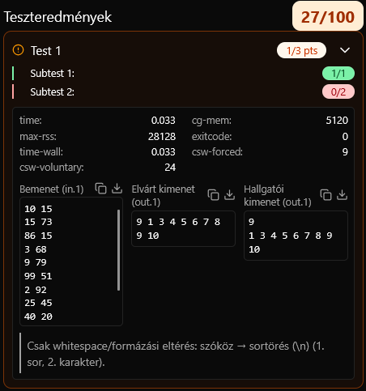

# ELTE Extras

A Firefox extension for [ELTE's Stuki editor](https://progalap.elte.hu/stuki/), [Speci](https://progalap.elte.hu/specifikacio/), and [Progenv](https://progenv.inf.elte.hu/hu): Adding whats already supposed to be there.

You can disable the changes made to the sites separately in the extension’s toolbar icon. Reload an affected page after changing its checkbox, as the extension doesn't auto reload them.

## Features

- History toggle in the header.
- Search saved structograms by name, UUID, or date.
- Reuses the editor's login session. Passwords are never requested by the extension.
- First-save naming dialog for new documents.
- Progenv sidebar dropdowns show each course and group, with direct topic links, task counts, scores, and deadlines.
- Hints on failed Progenv tests when output differs only in characters invisible by just looking.
- Draggable divider between the specification editor's Specification and Data columns.

## Install in Firefox

Requires Firefox 128 or later.

1. Download the signed **ELTE Extras `.xpi`** file from [Releases](https://github.com/mezozoltan/elte-extras/releases).
2. Open `about:addons` in Firefox and select **Extensions**.
3. Click the gear icon and choose **Install Add-on From File…**.
4. Select the downloaded `.xpi` file and confirm the installation and requested permissions.
5. Reload any open Stuki, Specifikáció, or Progenv tabs.

Open the toolbar's extensions menu to access or pin **ELTE Extras**. Its popup lets you enable or disable changes separately for each site.

To update manually, download the newer signed `.xpi` and repeat the installation steps.

[Firefox installation help](https://support.mozilla.org/en-US/kb/find-and-install-add-ons-add-features-to-firefox)

## Install in Chromium, Chrome, Brave, or Edge

Requires Chrome 148 or later to work.

1. Download the extension **ZIP** and extract it into a folder you will keep on your computer.
2. Open your browser's extensions page:
   - Chromium or Chrome: `chrome://extensions`
   - Brave: `brave://extensions`
   - Edge: `edge://extensions`
3. Enable **Developer mode**.
4. Click **Load unpacked** and select the extracted folder containing `manifest.json`.
5. Reload any open Stuki, Specifikáció, or Progenv tabs.

Keep the extracted folder in place, the browser loads the extension from it. Open the toolbar's extensions menu to access or pin **ELTE Extras**.

To update, replace the files in that folder with the newer version, click **Reload** on the extension's card in the extensions page.

[Chrome's unpacked-extension installation guide](https://developer.chrome.com/docs/extensions/get-started/tutorial/hello-world#load-unpacked)

## Progenv course dropdowns

The extension reads your course list using your current Progenv session, follows each course to its group page or group list, and shows compact topic links in a separate section below the three original navigation items (Kurzusok, Feladattár, Rólunk). For example, **Programozás · X. csoport** expands to show that group's topics plus course-level topics.

Individual task links appear only beneath topics with a deadline or closing date, regardless of completion percentage. Topics with upcoming deadlines appear first, earliest deadline first.

## Progenv output-difference hints

In **Beadások → Tests**, expand a failed test to compare the expected and submitted outputs. If the visible values match but the strings differ in whitespace or supported invisible characters, a small note explains the difference. Examples include an extra or missing final newline, trailing spaces, a tab instead of a space, LF versus CRLF line endings, a non-breaking space, a BOM, or a zero-width space. Hover over the note for the first differing line/character and the trailing-whitespace details.

This feature reads only test results already rendered in the page. It makes no network requests, performs no submissions or re-runs, and stores no test/output data. Hints update as test details load or submissions change.

## API and privacy

The extension runs on `https://progalap.elte.hu/stuki`, `https://progalap.elte.hu/specifikacio`, and their child paths, plus `https://progenv.inf.elte.hu/*`. Stuki history reads:

- `GET https://webprogramozas.inf.elte.hu:3000/me` using the existing session.
- `GET https://webprogramozas.inf.elte.hu:3001/structograms` using the returned access token.

Progenv reads the signed-in `/{locale}/courses` page and the course/group URLs linked from it. It uses the browser’s existing same-origin cookies without reading or persisting them.

There is no telemetry, deletion, or account-management functionality. When you explicitly confirm a first save, the extension renames the first function through the editor’s own controls and invokes its existing Save action. The editor then performs its normal authenticated `POST /structograms`; the extension does not construct a separate save request. The list endpoint already exists, the extension just adds a button for it.

This is an independent extension, not an official ELTE add-on. The original site's bundled code and CSS are not included in this repository.
