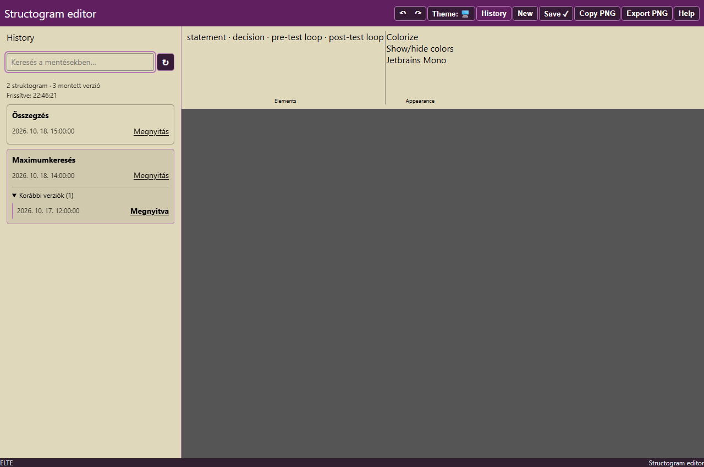
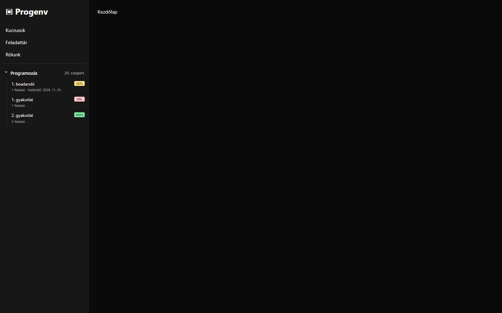

# Stuki History

A Firefox extension for [ELTE's Stuki editor](https://progalap.elte.hu/stuki/), [Speci](https://progalap.elte.hu/specifikacio/), and [Progenv](https://progenv.inf.elte.hu/hu): saved-diagram history, first-save naming, resizable Speci panels, and compact course shortcuts.



## Features

- History toggle beside the editor's Theme button, styled by the site's own CSS.
- Yellow panel below the header, shifting only the toolbar and diagram workspace on desktop.
- Search saved diagrams by name, UUID, or date.
- Expand earlier versions linked by `prev_id`, with the current version highlighted.
- Refresh after the saved UUID changes, every 30 seconds while visible and open, or manually.
- Reuses the editor's login session. Passwords are never requested by the extension; access tokens and diagram lists are not persisted.
- First-save naming dialog for new documents, including Ctrl+S. The chosen name is applied to the first function before invoking the editor’s own Save action.
- Progenv sidebar dropdowns show each course and group, open by default, with direct topic links, task counts, scores, and deadlines.
- Full group names appear beside Progenv course names, including custom group labels.
- Draggable divider between Speci’s Specification and Data columns, with a saved size ratio, keyboard controls, and panel-toggle support.
- Only display preferences are stored locally: Stuki panel visibility, collapsed Progenv course/group identifiers, and the Speci split ratio.

## Install in Firefox

Requires Firefox 128 or later. This is an unsigned development extension.

1. Download [stuki-history-1.5.0.zip](packages/stuki-history-1.5.0.zip) using GitHub's **Download raw file** control, or clone the repository.
2. Open `about:debugging#/runtime/this-firefox`.
3. Click **Load Temporary Add-on…** and choose the ZIP, or choose `manifest.json` from the cloned repository.
4. Reload Stuki or Progenv and sign in normally. On Stuki, click **History** beside **Theme**. On Progenv, course shortcuts appear automatically in a separate section below **Rólunk** in the sidebar. Allow the extension access to Progenv if Firefox requests it.

Click History again, or press Escape inside the panel, to close it. Temporary add-ons are removed when Firefox restarts. Persistent installation in standard Firefox requires Mozilla signing; the included package is not signed.

To update a temporary installation, reload it in `about:debugging` if loading unpacked files, or remove it and load the new ZIP. Then reload the Stuki tab.

[Hungarian installation instructions](TELEPITES.md) · [Mozilla temporary-installation documentation](https://extensionworkshop.com/documentation/develop/temporary-installation-in-firefox/)

## Progenv course dropdowns



The extension reads your course list using your current Progenv session, follows each course to its group page or group list, and shows compact topic links in a separate section below the three original navigation items (Kurzusok, Feladattár, Rólunk). For example, **Programozás · 20. csoport** expands to show that group's topics plus course-level topics such as beadandók. The heading toggles the dropdown; it starts open unless you previously collapsed it.

Topic rows show the name, completion percentage when supplied by the site, task count, and deadline. Original topic names are preserved. Topics with upcoming deadlines appear first, earliest deadline first; recently expired items follow, then undated items in their original order. A closing date is used when the topic has no separate deadline. Course codes are removed from the compact heading; the full group label is retained. Direct links preserve the current Hungarian or English locale. No group ID or personal course list is hardcoded.

The extension uses only same-origin GET requests for course and group pages; it does not open task pages in the background or submit work. It refreshes every five minutes while the page is visible. Course data and progress remain in memory, and are cleared when navigating to the login/logout page. Only collapsed dropdown identifiers are saved as display preferences.

Progenv's authenticated sidebar, course links, group redirect, and topic cards were inspected in a signed-in browser. Parser/layout tests also passed with locally captured page markup and mocked requests. The extension itself has not been installed into the signed-in browser, so live background-page fetching still needs confirmation after loading it in Firefox. The captured account markup and progress are not included in the repository; the example screenshot uses synthetic data.

## Diagram names

Click **Save** (or press **Ctrl+S**) on a new document to enter a name. Confirm with **Mentés** or Enter. Cancel or Escape leaves the document unsaved. Blank names are rejected. The first function is renamed in the editor before the normal save runs; its heading stays hidden if it was hidden before. Subsequent saves of the same document do not ask again.

The name is stored in `data.structograms[].name`, and History displays it. You can still change it manually using the diagram’s **F** operation.

Speci sends a separate top-level `name` field. Stuki's current save client does not. Server support for a separate Stuki save title has not been verified.

## Speci resizable panels

On [Speci](https://progalap.elte.hu/specifikacio/), drag the thin separator between Specification (1) and Data (2) to change their widths. The split is remembered. Double-click the separator to reset it; when focused, use Left/Right, Shift+Left/Right, Home, or End to adjust it with the keyboard.

The divider works with Visualization hidden. When Data or the entire left column is hidden, the divider disappears and the remaining column fills the available area. Re-enabling panels restores the saved split. History remains in its original left-side position. Monaco’s existing automatic layout updates the editors after resizing. This feature makes no network requests and does not change document content.

## Development

No build step or runtime dependencies are required. `content.js` / `model.js` handle Stuki, while `progenv.js` / `progenv-model.js` handle Progenv and `spec-resize.js` handles Speci.

Run the portable data-model checks with Node.js:

```sh
node tests/model.test.cjs
```

The save-dialog integration test requires Playwright and a locally downloaded copy of the deployed Stuki JavaScript bundle. The bundle is intentionally excluded from the repository. All network requests are intercepted:

```powershell
npm install
npx playwright install chromium
$env:STUKI_BUNDLE_PATH = 'C:/path/to/stuki-client.js'
npm run test:integration
```

Run the Progenv browser tests after installing Playwright:

```sh
npm run test:progenv
npm run test:spec
```

Those tests use synthetic fixtures and intercepted requests. They cover default-open dropdowns, collapse persistence, locale-aware safe links, group/course topic links, completion metadata, SPA sidebar replacement, streaming redirects, multiple groups, retries, login expiry, logout cleanup, and GET-only access. Optional `PROGENV_FIXTURE_DIRECTORY` and `PROGENV_CSS_PATH` variables enable testing against locally captured markup and CSS; those private fixtures are not committed.

Optionally set `TEST_BROWSER_PATH` to an installed Chromium executable. Repackage with PowerShell:

```powershell
./build.ps1
```

The tests cover version chains, forks, cycles, missing parents, duplicate entries, names, and safe links. Layout, search, authentication errors, server errors, empty results, mobile bounds, and keyboard behavior were also checked in an isolated Chromium browser with the site's actual CSS and mocked API responses. The deployed Stuki client was tested with intercepted requests to verify the first-save dialog, Ctrl+S, blank-name validation, cancel, Enter submission, exactly one save per confirmation, name persistence, version linking, preserving a hidden function header, and retrying a failed first save. Stuki save requests were not sent to a live authenticated account.

## API and privacy

The extension runs on `https://progalap.elte.hu/stuki`, `https://progalap.elte.hu/specifikacio`, and their child paths, plus `https://progenv.inf.elte.hu/*`. Stuki history reads:

- `GET https://webprogramozas.inf.elte.hu:3000/me` using the existing session.
- `GET https://webprogramozas.inf.elte.hu:3001/structograms` using the returned access token.

Progenv reads the signed-in `/{locale}/courses` page and the course/group URLs linked from it. It uses the browser’s existing same-origin cookies without reading or persisting them.

There is no telemetry, deletion, or account-management functionality. When you explicitly confirm a first save, the extension renames the first function through the editor’s own controls and invokes its existing Save action. The editor then performs its normal authenticated `POST /structograms`; the extension does not construct a separate save request. The list endpoint exists and requires authentication; the exact live response format and scope of returned records have not been verified with an authenticated account. Direct arrays and arrays under `structograms`, `items`, or `data` are supported. Unsupported formats produce an error.

This is an independent extension, not an official ELTE add-on. The original site's bundled code and CSS are not included in this repository.

The Speci divider tests cover mouse dragging, saved ratios, all 16 combinations of editor/data/visualization/history visibility, keyboard resizing, minimum widths, viewport changes, drag cancellation, and repeated injection. Set `SPEC_HTML_PATH` and `SPEC_CSS_PATH` to locally downloaded Speci HTML/CSS to run the same checks against its actual layout.
